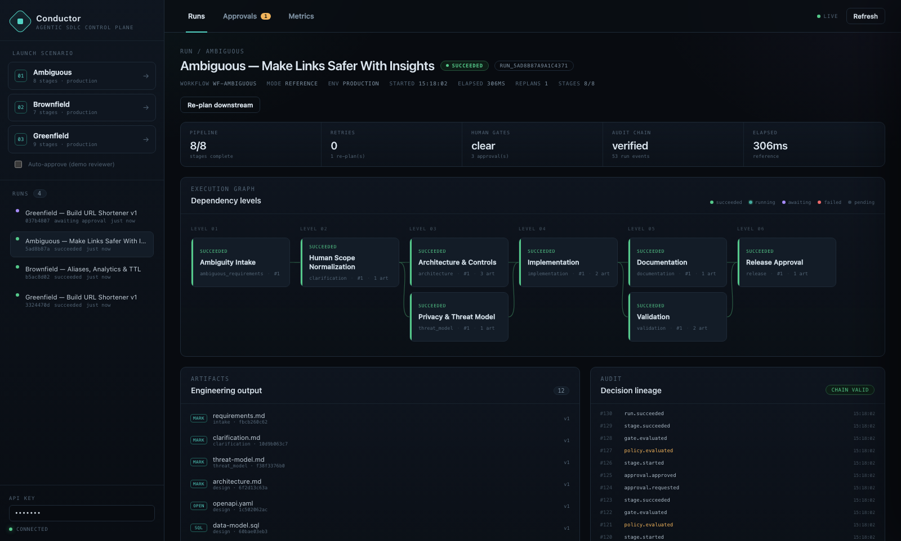
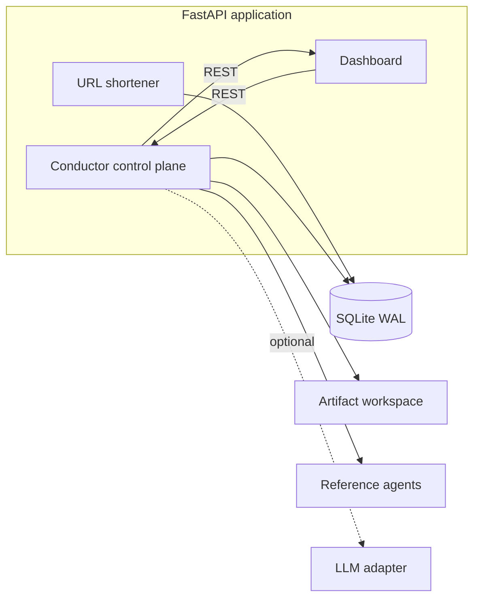

# Conductor — Agentic SDLC Control Plane + URL Shortener

A working prototype for the **Agentic Software Engineer** assignment: a production-grade
URL shortener plus an agentic orchestration layer that runs the full SDLC under explicit
governance.

The differentiator is not the URL shortener. It is **Conductor**: a stateful, non-linear
DAG engine with entry/exit gates, parallel branches and joins, human approval checkpoints,
bounded retries, fallback, compensation/rollback, safe-stop, policy guardrails, dynamic
re-planning, an append-only hash-chained audit log, and reliability metrics.



## Quick start

Requires Python 3.11+ and [uv](https://docs.astral.sh/uv/).

```bash
make install        # uv sync --all-extras
make demo           # greenfield scenario with a recorded demo reviewer
make demo-all       # greenfield + brownfield + ambiguous
make serve          # API + dashboard at http://localhost:8000
make test           # full test suite
make verify         # lint + tests
```

No external services, API keys or network access are required. The default agent mode is
deterministic and reproducible. An optional LLM adapter is available behind
`ASDLC_AGENT_MODE=llm`.

Without `uv`:

```bash
python3 -m venv .venv && source .venv/bin/activate
pip install -e ".[dev]"
asdlc demo --all
asdlc serve
```

## What the prototype demonstrates

| Assignment requirement | Where it is implemented | How to verify |
|---|---|---|
| Requirement understanding | `RequirementsAgent`, ambiguity intake | `scenarios/ambiguous.yaml`, `requirements.md` artifact |
| Task decomposition | typed `StageSpec` DAGs per scenario | `scenarios/*.yaml`, `docs/SCENARIOS.md` |
| Codebase reasoning | `ImpactAnalysisAgent` scans the real shortener modules | `impact-analysis.md` artifact |
| Non-linear orchestration | engine scheduler, replan closure | `run` detail graph, `replan.applied` audit event |
| Explicit dependency graph + gates | `graph.py`, `gates.py`, `StageSpec` | invalid DAG tests, gate audit events |
| Sequential + parallel + sync | topological levels, thread-pool batches, join stages | `validation` stage joins `implementation` + `test_plan` |
| Cross-stage context + lineage | versioned artifacts, decisions, `AgentContext` | artifact drawer, version `v2` after re-plan |
| Human approvals | approval table, API, dashboard inbox | run pauses in `AWAITING_APPROVAL` |
| Bounded retries + fallback | `max_retries`, jittered backoff, `fallback_agent` | brownfield policy retry; engine tests |
| Rollback / compensation | reverse-topological compensation | `rollback.completed`, engine test |
| Safe-stop / resume | operator control + budgets | dashboard / `asdlc safe-stop` |
| Policy guardrails | `policy.py` (SEC-001/2/3, LIC-001, CHG-001/2, REL-001) | brownfield secret blocked then remediated |
| Audit-grade observability | SHA-256 hash-chained event log | `/audit/verify`, tamper tests |
| Reliability metrics | `metrics.py` | `/metrics`, dashboard metrics view |
| Dynamic re-planning | reverse-dependency impact closure | ambiguous scenario, `__replan__` approval |
| Engineering output | generated module + executed tests | `test-report.md`, `validation-log.txt` |
| Risk + validation | policy, tests, threat model, risk register | `docs/RISKS.md`, `docs/TESTING.md` |

## Architecture at a glance



The engine is a bounded, single-node executor with a durable SQLite state store. Each run is
a DAG of stages; each stage declares dependencies, gates, approvals, retry budget, failure
policy, compensation and policy tags. The engine selects ready stages, runs independent
stages in parallel, joins at dependent stages, and persists every state transition, artifact,
decision and approval to the audit chain.

Full detail: [`docs/ARCHITECTURE.md`](docs/ARCHITECTURE.md) and
[`docs/ORCHESTRATION.md`](docs/ORCHESTRATION.md).

## The three scenarios

| Scenario | Story | What it proves |
|---|---|---|
| **Greenfield** | Build URL shortener v1 | parallel design, join sync, release gate, human deployment approval |
| **Brownfield** | Add aliases, analytics, TTL | real codebase impact scan, sandbox migration, policy-blocked secret retried clean, regression evidence, change-controlled deploy |
| **Ambiguous** | "Make links safer with insights" | ambiguity detection, human normalization, governed mid-flight re-plan, artifact lineage (`v2`) |

Run one from the CLI:

```bash
uv run asdlc run greenfield                  # pauses at the publish gate
uv run asdlc approve <run_id> --rationale "evidence reviewed"
uv run asdlc status <run_id>
uv run asdlc audit-verify <run_id>
```

Or launch from the dashboard. With **Auto-approve** enabled, a recorded `demo-reviewer`
approves gates so the whole run completes deterministically. In production
(`ASDLC_ENV=production`) auto-approval is rejected by policy.

## URL shortener

The shortener is a real service, not a mock:

```bash
curl -s -X POST http://localhost:8000/api/v1/links \
  -H 'X-API-Key: dev-key' -H 'Content-Type: application/json' \
  -d '{"url":"https://example.com/launch","custom_alias":"launch","ttl_seconds":86400}'
# {"code":"launch","short_url":"http://localhost:8000/launch", ...}

curl -i http://localhost:8000/launch          # 302 + click analytics
curl -s http://localhost:8000/api/v1/links/launch/analytics -H 'X-API-Key: dev-key'
```

Controls:

- **URL safety:** http/https only; rejects `file:`, `javascript:`, credentials, `localhost`,
  private/loopback/link-local/reserved IPv4/IPv6, integer and hex IPv4 forms, metadata hosts.
- **Abuse controls:** token-bucket rate limits on management and redirect paths.
- **Correctness:** transactional code reservation, collision retry, `Idempotency-Key`,
  unique custom aliases, reserved route names, TTL expiry, soft delete.
- **Analytics:** salted visitor hashes (no raw IP storage), daily series, unique visitors,
  top referrers and countries.
- **Ops:** `/healthz`, `/readyz`, Prometheus `/metrics`, request IDs, security headers.

## Control-plane API

| Method | Path | Purpose |
|---|---|---|
| `GET` | `/api/v1/scenarios` | scenario catalog + stage graph |
| `POST` | `/api/v1/runs` | launch a run (`auto_approve` for demos) |
| `GET` | `/api/v1/runs` | run history |
| `GET` | `/api/v1/runs/{id}` | full snapshot: stages, artifacts, decisions, approvals, audit, metrics |
| `POST` | `/api/v1/runs/{id}/approve` | approve a gate or re-plan |
| `POST` | `/api/v1/runs/{id}/reject` | reject and stop |
| `POST` | `/api/v1/runs/{id}/replan` | impact-based re-plan |
| `POST` | `/api/v1/runs/{id}/safe-stop` | operator stop |
| `POST` | `/api/v1/runs/{id}/resume` | resume a safe-stopped run |
| `GET` | `/api/v1/runs/{id}/audit` | events + chain verification |
| `GET` | `/api/v1/approvals` | approval inbox |
| `GET` | `/api/v1/artifacts/{id}` | artifact content |
| `GET` | `/api/v1/metrics/summary` | reliability metrics |
| `GET` | `/metrics` | Prometheus exposition |

All `/api/v1` routes require `X-API-Key` (default `dev-key`).

## Orchestration semantics

- **State machine:** `PENDING → READY → RUNNING → AWAITING_APPROVAL → SUCCEEDED | FAILED |
  ROLLED_BACK | SAFE_STOPPED | CANCELLED`
- **Gates:** entry preconditions + exit evidence (`artifact_present`, `requirements_normalized`,
  `tests_passed`, `release_ready`). Failed exit gates consume retries.
- **Approvals:** stage or re-plan approvals pause the run; approve resumes, reject stops with
  a recorded rationale; every decision is audited with actor and timestamp.
- **Retries:** bounded exponential backoff with jitter; non-retryable classification; optional
  fallback agent; policy-retryable findings consume budget.
- **Rollback:** reverse-topological compensation for succeeded stages; compensation failure
  escalates to `SAFE_STOPPED` for human action.
- **Safe-stop:** operator action or budget breach (wall clock / attempts) cancels pending
  stages, preserves artifacts, and permits explicit resume.
- **Re-plan:** a changed stage triggers the reverse-dependency closure; impacted stages become
  `STALE/PENDING`; prior artifacts remain as lineage; each re-execution creates a new version.
- **Audit:** every event commits to the previous hash; `/audit/verify` recomputes the chain.
- **Metrics:** success rate, retry frequency, rollback frequency, MTTR, e2e p50/p95, stage p50/p95.

Definitions and failure semantics: [`docs/ORCHESTRATION.md`](docs/ORCHESTRATION.md).

## Testing

```bash
make test
make cov
make verify
```

The suite covers URL validation and API behavior, analytics, graph validation and cycles,
policy rules, audit tamper detection, retries, parallel joins, approvals, rollback, safe-stop,
re-planning, budgets, all three scenarios end-to-end, the REST API, and metrics. See
[`docs/TESTING.md`](docs/TESTING.md).

## Project layout

```
src/agentic_sdlc/
  api.py                 FastAPI app factory
  cli.py                 asdlc CLI
  config.py              environment settings
  db.py                  SQLite schema + transaction helper
  models.py              API models
  shortener/             codec, security, repository, service, API, rate limiting
  orchestrator/
    models.py            StageSpec, WorkflowDefinition, AgentContext
    graph.py             DAG validation, levels, impact closure
    audit.py             hash-chained audit log
    policy.py            declarative guardrails
    gates.py             entry/exit gate registry
    store.py             runs, stages, artifacts, decisions, approvals
    engine.py            scheduler, retries, approvals, rollback, re-plan
    metrics.py           reliability metrics + Prometheus
    scenarios.py         YAML loader + rehydration
    agents/              reference agents + optional LLM adapter
  web/                   dashboard (no build step)
scenarios/               greenfield, brownfield, ambiguous
tests/                   unit, integration, e2e
docs/                    architecture, orchestration, scenarios, testing, risks, summary
```

## Key decisions

- **Custom engine over Temporal/Prefect/LangGraph** so governance is explicit, testable code
  rather than framework configuration. See `docs/DECISIONS.md` (ADR-001).
- **Deterministic reference agents** that do real work and execute real tests; LLM adapter
  behind a mode switch. Reproducible review beats a non-deterministic demo.
- **SQLite + in-process threads** for zero-infra reviewability. The store/engine seams map to
  Postgres + queue workers + object storage in production. See ADR-003.
- **Hash-chained audit log** rather than mutable logs; verification is a first-class endpoint.
- **Policy as rules** with retryability/obligations; denials are persisted decisions, not
  console warnings.

## Limitations and production path

- Single-node execution; no crash-recovery mid-stage, distributed leases, or horizontal scale.
- SQLite single-writer; artifacts live on local disk.
- In-process rate limiting and API-key auth, not Redis/OAuth2/mTLS.
- DNS rebinding is documented as residual risk; production needs egress pinning/proxy.
- Reference agents are deterministic; LLM mode is an adapter, not an evaluated model pipeline.

The production path and the exact seams to change are documented in
[`docs/ARCHITECTURE.md`](docs/ARCHITECTURE.md#production-path) and
[`docs/RISKS.md`](docs/RISKS.md).

## Documentation index

- [Architecture](docs/ARCHITECTURE.md)
- [Orchestration model](docs/ORCHESTRATION.md)
- [Agents and artifacts](docs/AGENT_MODEL.md)
- [Scenarios](docs/SCENARIOS.md)
- [API reference](docs/API.md)
- [Testing](docs/TESTING.md)
- [Decisions (ADRs)](docs/DECISIONS.md)
- [Risks and trade-offs](docs/RISKS.md)
- [Final engineering summary](docs/FINAL_SUMMARY.md)
- [Design spec](docs/superpowers/specs/2026-10-30-agentic-sdlc-url-shortener-design.md)
- [Implementation plan](docs/PLAN.md)
