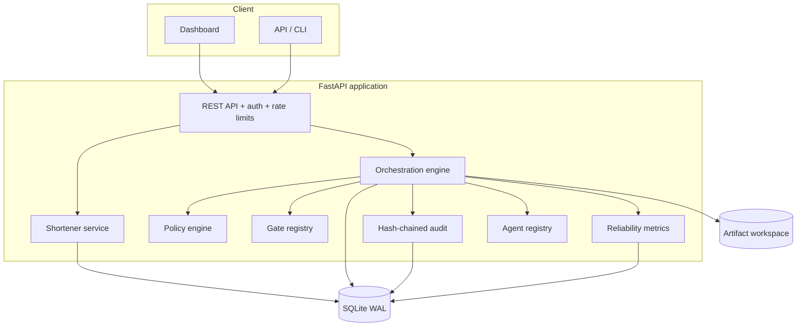
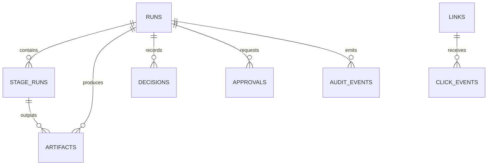
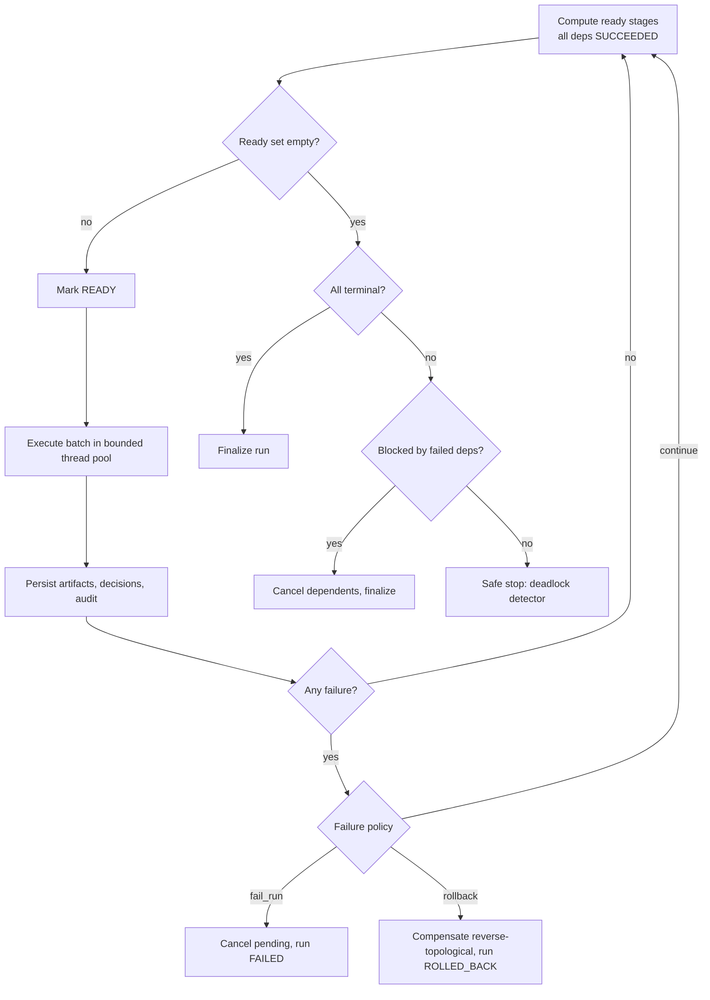
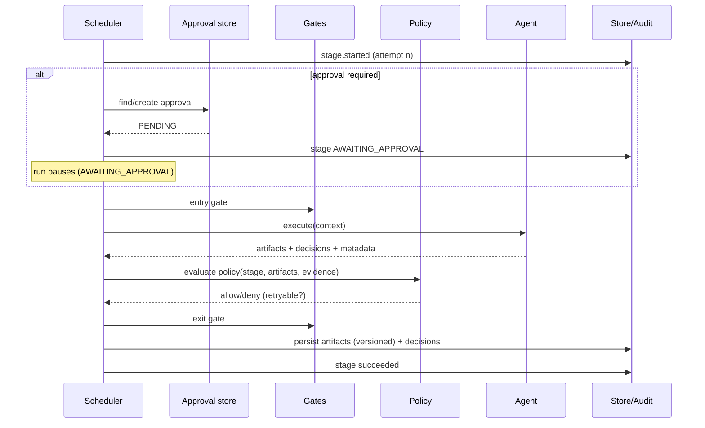

# Architecture

## 1. System context

Conductor is a single deployable FastAPI application with three responsibilities:

1. **URL shortener** — the concrete engineering product.
2. **Agentic SDLC control plane** — plans, executes, governs and audits work on that product.
3. **Operator dashboard** — run visibility, approvals, artifact inspection and metrics.

It is deliberately zero-infrastructure: SQLite (WAL) for state and the local filesystem for
artifact workspaces. This keeps the prototype reviewable and makes every control visible in
code rather than hidden behind a workflow framework.



## 2. Component responsibilities

| Component | Responsibility | Key files |
|---|---|---|
| API layer | HTTP semantics, validation, auth, rate limiting, error mapping, security headers | `api.py`, `shortener/api.py`, `orchestrator/api.py` |
| Shortener service | URL safety, alias rules, TTL/idempotency, redirect orchestration | `shortener/service.py`, `security.py`, `codec.py` |
| Repository | Transactional persistence, collision-safe reservation, analytics aggregation | `shortener/repository.py` |
| Orchestration engine | DAG scheduling, stage lifecycle, retries, approvals, rollback, safe-stop, re-plan | `orchestrator/engine.py` |
| Graph module | Validation, topological levels, reverse-dependency closure, compensation order | `orchestrator/graph.py` |
| Policy engine | Named security/change-control rules with deny/allow, severity, retryability, obligations | `orchestrator/policy.py` |
| Gate registry | Entry preconditions and exit evidence checks | `orchestrator/gates.py` |
| Store | Durable runs/stages/artifacts/decisions/approvals/audit | `orchestrator/store.py` |
| Audit log | Append-only SHA-256 hash chain + verification | `orchestrator/audit.py` |
| Metrics | Success, retry, rollback, MTTR, latency percentiles, Prometheus | `orchestrator/metrics.py` |
| Agents | Reference implementations that produce real artifacts and execute tests; optional LLM adapter | `orchestrator/agents/reference.py`, `llm.py` |
| Scenario loader | YAML → validated `WorkflowDefinition` | `orchestrator/scenarios.py`, `scenarios/*.yaml` |
| Dashboard | Operator visibility and approval inbox | `web/` |

## 3. Data model



| Table | Purpose |
|---|---|
| `links` | Short code, destination, TTL, soft-delete, idempotency key, click counter |
| `click_events` | Append-only click facts: referrer, UA, salted visitor hash, country |
| `runs` | Scenario, workflow version, status, mode, context JSON, replan count |
| `stage_runs` | Current stage state: status, attempt, timestamps, error, approval, stale flag |
| `artifacts` | Versioned content, SHA-256 hash, parent artifact, supersession pointer |
| `decisions` | Agent/policy/approval/re-plan decisions with rationale and actor |
| `approvals` | Stage and re-plan approval requests and human decisions |
| `audit_events` | Append-only, hash-chained event log (`prev_hash`, `hash`) |
| `workflows` | Immutable workflow definition snapshot per version |

Artifacts are content-addressed by SHA-256 and versioned per `(run, stage, name)`. A re-plan
never deletes history: the previous version is marked `superseded_by` and the new version
points at it through `parent_artifact_id`. This is the lineage the assignment asks for.

## 4. Orchestration model

### 4.1 Workflow definition

A scenario YAML compiles to a `WorkflowDefinition` of `StageSpec`s. Each stage declares:

- identity and agent
- `depends_on` edges
- `entry_gate` and `exit_gate`
- `requires_approval`
- `max_retries` and timeout
- `failure_policy` (`fail_run`, `rollback`, `continue`)
- `compensation` handler name
- `policy_tags`
- optional `fallback_agent`

The graph is validated on load: duplicate IDs, missing dependencies, self-dependencies and
cycles are rejected before a run can start.

### 4.2 Scheduler



Properties:

- **Deterministic:** ready stages are sorted by id before scheduling; audit order is
  serialized by the audit lock.
- **Parallel with synchronization:** independent stages run in a thread pool; a join stage is
  not ready until every dependency is `SUCCEEDED`.
- **Bounded:** `max_parallel`, per-stage timeouts, run wall-clock budget and total attempt budget.
- **No silent hangs:** if no stage is ready and nothing is running, the deadlock detector
  safe-stops the run.

### 4.3 Stage execution



Context passed to each stage includes:

- scenario requirement and environment
- latest upstream artifacts for every dependency
- all decisions recorded so far
- attempt number
- approval record (reviewer + rationale)
- re-plan reason when the stage is stale
- a per-run workspace path

### 4.4 Approvals

An approval-required stage creates a record, sets the stage to `AWAITING_APPROVAL`, and returns
control to the operator. The run status becomes `AWAITING_APPROVAL`. Approve resumes the
scheduler; reject cancels the stage and fails the run. Re-plan approvals use a synthetic
`__replan__` stage id and carry the impact targets and reason in their context.

Approvals are scoped to the current stage epoch: a re-plan clears `stage_runs.approval_id`, so
a previous approval cannot be reused for a re-executed high-impact stage.

### 4.5 Retries, fallback, rollback, safe-stop

- **Retries:** attempt `n` failure is retryable if the agent says so (or policy marks the
  violation retryable) and `n <= max_retries`. Delay is exponential with jitter, capped by
  `retry_max_delay`. Every attempt is audited.
- **Fallback:** after the first failed attempt, a stage with `fallback_agent` uses the fallback
  agent for subsequent attempts.
- **Rollback:** a `rollback` failure policy compensates all succeeded stages in reverse
  topological order. A failed compensation escalates to `SAFE_STOPPED`; no further stages run.
- **Safe-stop:** operator action or budget exhaustion cancels non-terminal stages, preserves
  state and artifacts, records the reason, and allows an explicit resume.

### 4.6 Re-planning

A changed stage implies its reverse-dependency closure is stale. `request_replan` computes
that closure (or accepts explicit targets), resets impacted stage runs to `PENDING/STALE`,
increments the run's replan counter, records a decision and audit event, and re-executes. Prior
artifacts remain available as lineage. The ambiguous scenario demonstrates an auto-triggered,
approval-gated re-plan that regenerates `implementation`, `tests` and `documentation` as `v2`.

### 4.7 Policy guardrails

| Rule | Scope | Behavior |
|---|---|---|
| `SEC-001` | code/sql/test artifacts | denies hardcoded AWS keys, private keys, generic secrets (retryable) |
| `SEC-002` | code artifacts | denies SSN/PII patterns (retryable) |
| `SEC-003` | architecture stage | requires documented SSRF/private/redirect controls (retryable) |
| `LIC-001` | code artifacts | denies GPL-3 references (non-retryable) |
| `CHG-001` | `production_deploy` stages | requires recorded approval + green test evidence |
| `CHG-002` | production deploy | denies during a change freeze |
| `REL-001` | production deploy | requires rollback documentation |

Denials become persisted decisions and audit events. A retryable denial consumes the stage's
retry budget; the brownfield scenario demonstrates a secret leaked on attempt 1 and remediated
on attempt 2.

### 4.8 Audit and observability

Every state transition, gate result, policy evaluation, approval, retry, rollback and re-plan
is appended to `audit_events`. Each record contains:

```
hash = SHA256(prev_hash + "|" + canonical_json({run_id, stage_id, event_type, actor, payload, created_at}))
```

`/api/v1/runs/{id}/audit/verify` recomputes the global chain and reports the first bad sequence
number. Tampering with any payload or deleting a record invalidates verification.

Metrics are derived, never written by agents:

- **success rate** = succeeded / terminal runs
- **retry frequency** = retry schedules / total stage attempts (re-plan executions count as attempts, not retries)
- **rollback frequency** = runs with rollback / all runs
- **MTTR** = mean time from first failure to recovery or terminal failure
- **e2e latency** = run start → end, p50/p95
- **stage latency** = stage start → end, p50/p95

## 5. Shortener design

- **Code allocation:** 7-character Base62, 62^7 keyspace, transactional unique reservation,
  collision retry. Custom aliases are 3-32 chars and reserve route names.
- **URL validation:** scheme allowlist, credential rejection, private/loopback/link-local/
  reserved/multicast IP blocking, integer and hex IPv4 parsing, metadata host blocking,
  length and control-character checks.
- **Idempotency:** unique key; same target replays return the original link, a different target
  returns 409.
- **Analytics:** inserts click facts and increments a counter in one transaction; aggregation
  is on demand with `(link_id, clicked_at)` and `(code, clicked_at)` indexes.
- **Privacy:** visitor identifiers are salted SHA-256 hashes, truncated; raw IPs are never stored.
- **Rate limiting:** token bucket keyed by API key or client address; management and redirect
  limits are independent.

## 6. Concurrency and consistency

- SQLite runs in WAL mode with `BEGIN IMMEDIATE` for writes and a 30s busy timeout.
- Each store operation uses a short-lived connection; no connection is shared across threads.
- Parallel stage workers persist independently; the audit log serializes appends with a lock
  so the hash chain is linear.
- The engine holds a per-run re-entrant lock, preventing two operator actions from executing
  the same run concurrently.
- Approval and stage transitions are conditional SQL updates (`WHERE status = ...`) to avoid
  double transitions.

Known constraint: `BEGIN IMMEDIATE` serializes all writers. That is acceptable for the
prototype and a deliberate trade-off for reviewability.

## 7. Deployment and operations

- Single process: `asdlc serve --host 0.0.0.0 --port 8000`.
- Health: `/healthz` (liveness), `/readyz` (DB probe), `/metrics` (Prometheus).
- Data: `var/agentic_sdlc.db`, artifacts under `var/runs/<run_id>/artifacts/...`.
- Configuration: `ASDLC_*` environment variables (see `.env.example`).
- Container: `docker build -t conductor . && docker run -p 8000:8000 conductor`.

## 8. Production path

The prototype is intentionally a modular monolith. The seams for production are explicit:

| Prototype | Production change | Why |
|---|---|---|
| SQLite | Postgres with migrations | concurrent writers, replication, backups |
| In-process threads | queue-backed workers + leases | crash recovery, horizontal scale |
| Local artifact files | object storage (S3) + checksums | durability, retention, audit |
| In-process rate limiter | Redis token bucket | shared limits across replicas |
| API key | OAuth2/OIDC + mTLS + Vault | identity, least privilege, secret rotation |
| Polling dashboard | SSE/WebSocket event stream | live updates at scale |
| Single audit chain | append-only ledger/WORM + periodic anchoring | regulatory retention |
| No DNS pinning | egress proxy + resolve/pin at click time | DNS rebinding defense |
| Reference agents | evaluated model pipeline + tool sandbox | quality, safety, cost controls |

The engine interfaces (`OrchestratorStore`, `Agent`, `PolicyEngine`, `AuditLog`) are the
boundaries where these replacements happen without rewriting the scheduler.

## 9. Related documents

- [Orchestration model](ORCHESTRATION.md)
- [Scenarios](SCENARIOS.md)
- [Testing](TESTING.md)
- [Decisions](DECISIONS.md)
- [Risks](RISKS.md)
- [Final summary](FINAL_SUMMARY.md)
