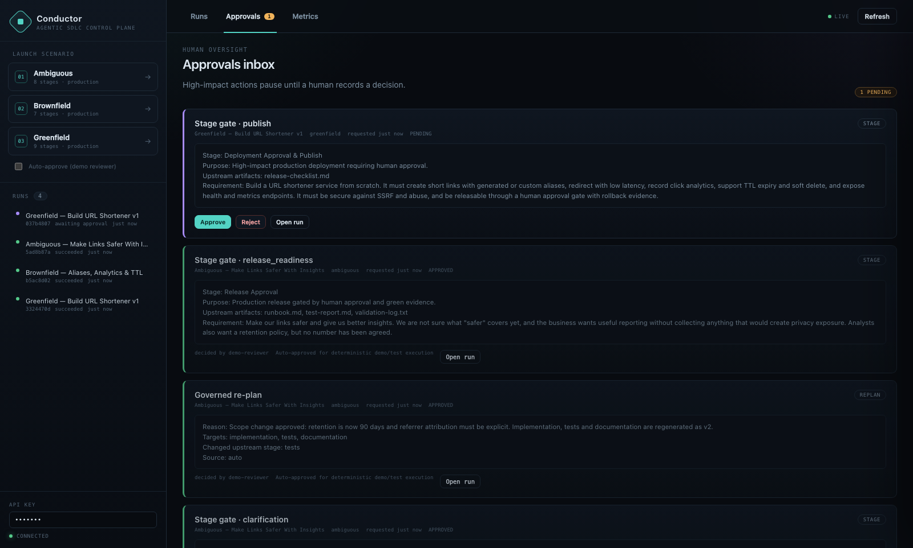
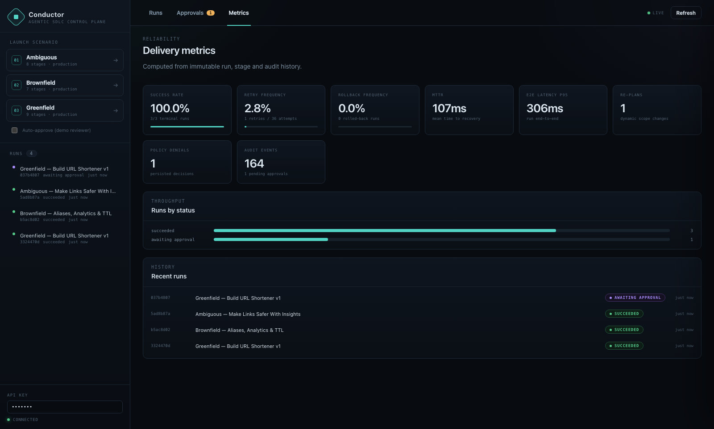

# Final Engineering Summary

## 1. Executive summary

I built **Conductor**, an agentic SDLC control plane, around a production-grade **URL
shortener**. The shortener is the work product; Conductor is the system that plans, executes,
governs, validates and audits the work.

The prototype runs end-to-end with one command, uses no external services, and executes three
real scenarios: greenfield, brownfield and ambiguous. Each scenario produces versioned
artifacts, passes gates, records approvals, writes a hash-chained audit trail and contributes
to reliability metrics.

The central design choice is that **orchestration is explicit code**, not framework
configuration. A reviewer can read the DAG validation, scheduler, gates, policy rules, retry
loop, compensation order and re-plan closure in a handful of files and see exactly why a run
behaved the way it did.

```bash
make install && make demo-all
make serve   # http://localhost:8000
make verify  # lint + 100 tests
```

## 2. Plan and rationale

### 2.1 Interpretation of the brief

The assignment is not "build a URL shortener." It is "show how an agentic system turns a
requirement into a reviewable engineering outcome under controlled autonomy." The URL shortener
provides a realistic domain with APIs, analytics, security, migrations and release concerns.
The scoring weight is on orchestration, decomposition, validation and judgment.

### 2.2 Decomposition

1. **Requirement understanding** — normalize intent, surface ambiguity, define acceptance
   criteria, identify NFRs.
2. **Architecture** — components, API contract (OpenAPI), data model, security controls,
   trade-offs.
3. **Threat model** — STRIDE, abuse cases, mitigations, residual risk.
4. **Implementation** — generate the shortener core and executable tests.
5. **Validation** — execute generated tests in isolation; only pass with process exit 0.
6. **Documentation** — runbook, rollback, SLOs, limitations.
7. **Release readiness** — checklist, evidence, observability and rollback proof.
8. **Human release gate** — a person approves the high-impact action.
9. **Brownfield additions** — impact analysis, migration, API compatibility, regression.
10. **Ambiguity handling** — clarification approval and a governed re-plan with lineage.

Dependencies follow the natural SDLC: requirements → design/threat model → implementation/test
plan → validation join → docs/readiness → approval → release. Parallel branches are used where
the work is genuinely independent.

### 2.3 Why this architecture

- **Custom DAG engine** (ADR-001): governance is the differentiator; it must be inspectable.
- **Deterministic reference agents** (ADR-002): reproducible evidence; real code execution.
- **SQLite modular monolith** (ADR-003): zero-infrastructure review; explicit production seams.
- **Hash-chained audit** (ADR-004): tamper evidence, not just logs.
- **Named policy rules** (ADR-005): enforcement with explainable decisions.
- **Human gates + constrained auto-approval** (ADR-006): controlled autonomy.
- **Impact-closure re-planning** (ADR-007): non-linear execution with lineage.
- **No-build dashboard** (ADR-008): reviewability.

## 3. What was built

### 3.1 URL shortener

| Capability | Implementation |
|---|---|
| Create short link | `POST /api/v1/links`, custom alias, TTL, idempotency key |
| Redirect | `GET /{code}`, 302, click recording, no-store/noindex |
| Metadata / delete | `GET` / `DELETE /api/v1/links/{code}`, soft delete |
| Analytics | totals, unique visitors, daily series, top referrers/countries |
| Security | scheme allowlist, SSRF/private-IP blocking, API key, rate limits, headers |
| Reliability | transactional reservation, collision retry, TTL expiry, WAL, health/readiness |
| Observability | Prometheus `/metrics`, request IDs, audit of orchestration actions |

### 3.2 Orchestration layer

| Capability | Implementation |
|---|---|
| Workflow model | `StageSpec` / `WorkflowDefinition`, YAML scenarios, validation |
| DAG scheduling | topological levels, ready-set selection, bounded thread-pool batches |
| Join synchronization | dependency-based readiness, no barriers needed |
| Gates | entry + exit registry (`artifact_present`, `tests_passed`, `release_ready`, …) |
| Human approvals | stage and re-plan approvals, actor/rationale, inbox, pause/resume |
| Policy | secrets, PII, SSRF design, license, production change control, freeze, rollback |
| Retries | bounded exponential backoff + jitter, fallback agent, retryable classification |
| Rollback | reverse-topological compensation, safe-stop on compensation failure |
| Safe-stop | operator + wall-clock/attempt budgets, state preservation, resume |
| Re-planning | reverse-dependency closure, stale reset, governed approval, artifact lineage |
| Context | requirement, upstream artifacts, decisions, attempt, replan reason, approval |
| Audit | append-only SHA-256 hash chain, verification endpoint, tamper tests |
| Metrics | success, retries, rollbacks, MTTR, e2e/stage p50/p95, policy denials, replans |
| Interfaces | REST API, CLI, dashboard |

### 3.3 Artifact inventory (greenfield)

`requirements.md`, `architecture.md`, `openapi.yaml`, `data-model.sql`, `threat-model.md`,
`generated/shortener_core.py`, `generated/test_shortener_core.py`, `test-plan.md`,
`test-report.md`, `validation-log.txt`, `runbook.md`, `release-checklist.md`,
`deployment-record.md`.

Brownfield adds `impact-analysis.md`, `migrations/002_aliases_analytics_ttl.sql`,
`migration-verification.txt`, `api-compatibility.md`, extension module/tests.
Ambiguous adds `clarification.md` and `v2` regenerated artifacts.

## 4. Orchestration walkthrough

A run proceeds as follows:

1. **Launch** validates the scenario and persists the workflow snapshot, run and stage rows.
2. **Schedule** selects every stage whose dependencies succeeded. Parallel stages run as a batch.
3. **Gate** checks entry preconditions, then the agent executes with the full upstream context.
4. **Validate** evaluates policy, then the exit gate. Failures consume retry budget.
5. **Persist** artifacts as immutable versions, decisions with rationale, and a hash-chained
   audit event for every action.
6. **Approve** high-impact stages pause in `AWAITING_APPROVAL`; a human records a decision.
7. **Re-plan** on an upstream change resets the reverse-dependency closure and re-executes,
   producing `v2` artifacts while preserving `v1` lineage.
8. **Finalize** when all stages are terminal; metrics are derived from the recorded history.

Failure semantics are defined in [ORCHESTRATION.md](ORCHESTRATION.md). The important property is
that every abnormal path ends in a recorded, inspectable state: `FAILED`, `ROLLED_BACK` or
`SAFE_STOPPED` — never a silent hang.

## 5. Scenario outcomes

### Greenfield

- 9 stages, two parallel design branches, validation join, readiness gate, release approval.
- Without auto-approval, run pauses at `publish`; approve resumes; reject fails.
- Evidence: 13 artifacts, valid audit chain, release checklist with rollback, deployment record.

### Brownfield

- Impact analysis scans the real `shortener/*.py` modules.
- Migration is authored and applied to a sandbox SQLite DB; columns and preserved rows verified.
- Attempt 1 of implementation contains an AWS key; `SEC-001` denies it; attempt 2 is clean.
- Deploy requires approval and green regression evidence.
- Evidence: retry frequency reflects 1 retry, policy denial persisted, audit valid.

### Ambiguous

- Intake surfaces five ambiguities and three blocking questions.
- Human approves the normalized interpretation before design.
- After tests, a scope change triggers an approval-gated re-plan of `implementation`, `tests` and
  `documentation`; artifacts are regenerated as `v2`.
- Release requires a third human approval.
- Evidence: `replan_count=1`, three approvals, `v2` lineage, valid audit.





## 6. Validation evidence

- **100 tests passing**, **90% statement coverage**.
- Engine tests cover parallel peak = 2, joins, retries, policy retries, approvals, rejection,
  rollback compensation, safe-stop/resume, re-plan lineage, budgets and unknown agents.
- Audit tests detect payload tampering and record deletion.
- Scenario tests assert the specific evidence: brownfield attempt 2, ambiguous `v2`, approval
  records, audit verification, metrics.
- UI verified in headless Chrome: run DAG, stage drawer, approvals inbox, metrics view.
- Demo metrics (representative, from `make demo-all` on a fresh database):
  - 3/3 terminal runs succeeded (100%)
  - 1 retry / 28 attempts (3.6%)
  - 1 policy denial (remediated)
  - 1 governed re-plan
  - e2e p50 251ms, p95 306ms
  - audit chain valid across 130 events

## 7. Risks and trade-offs

The top risks are agent-generated insecure code, unapproved production change, partial writes,
compensation failure and audit forgery. Each has a named control, a test where feasible, and a
documented residual risk in [RISKS.md](RISKS.md). Key trade-offs:

- **Reviewability over scale**: SQLite, single node, in-process threads.
- **Determinism over generativity**: reference agents by default, optional LLM adapter.
- **Explicit governance over framework convenience**: custom engine.
- **Best-effort rollback**: failed compensation escalates to safe-stop rather than pretending.
- **Tamper evidence, not immutability**: a DB writer could rewrite the chain; production anchors
  externally.

## 8. Assumptions

- Single tenant, single node, trusted operator with the API key.
- "Production" release is simulated; no real deployment target.
- Reference artifacts are generated from deterministic templates, not a live model.
- The reviewer has Python 3.11+ and can run `uv`.
- No external identity provider, queue, object store or Redis is available.

## 9. Limitations

- No crash recovery mid-stage; SQLite is single-writer.
- In-process rate limiting; no cross-replica coordination.
- API-key auth; no OAuth2/OIDC, rotation or per-tenant policy.
- DNS rebinding is a residual SSRF risk; no egress pinning.
- Analytics are computed on demand; no pre-aggregation or retention job.
- The dashboard polls; no WebSocket/SSE.
- The LLM adapter has no live-provider contract test or quality evaluation.
- Re-plan is stage-level, not file-level; artifact diffing is manual.

## 10. Assignment requirement mapping

| Core requirement | Evidence |
|---|---|
| 1. Requirement understanding | `RequirementsAgent`, ambiguous intake, acceptance criteria, `requirements.md` |
| 2. Task decomposition | YAML DAGs, dependency tables in `docs/SCENARIOS.md`, typed `StageSpec` |
| 3. Codebase reasoning | `ImpactAnalysisAgent` scans real modules; API/data-flow impact table; additive migration |
| 4. Workflow orchestration | `engine.py`, `graph.py`, gates, approvals, retries, rollback, safe-stop, policy, audit, metrics, re-plan; tests |
| 5. Engineering output | shortener code, OpenAPI, schema, tests, runbook, release artifacts; generated tests executed |
| 6. Validation and risk control | gates, policy, test report, threat model, risk register, approvals |
| 7. Controlled autonomy | approval checkpoints, production auto-approve denial, safe-stop, audit actor/rationale |
| 8. Final summary | this document + architecture/orchestration/testing/risk docs |

| Deliverable | Location |
|---|---|
| Working prototype | `make demo`, `make serve` |
| Architecture overview | `docs/ARCHITECTURE.md` |
| Three scenarios | `scenarios/*.yaml`, `docs/SCENARIOS.md`, e2e tests |
| Setup instructions | `README.md`, `Makefile`, `.env.example`, `Dockerfile` |
| Testing, limitations, trade-offs | `docs/TESTING.md`, `docs/RISKS.md`, this summary |

## 11. Review in ten minutes

```bash
make install
make demo-all                 # 3 scenarios, approvals recorded as demo-reviewer
make test                     # 100 tests
make serve                    # open http://localhost:8000
```

In the dashboard:

1. Open the **Ambiguous** run and inspect the DAG, then click `implementation` → Artifacts →
   compare `v2` versions; open Decisions and Policy.
2. Open **Approvals** and note the gate contexts, actors and rationale.
3. Open **Metrics** and read success, retry, MTTR and latency.
4. Launch **Greenfield** without auto-approve, open `publish`, and approve it.

Then read `docs/ARCHITECTURE.md` and `docs/ORCHESTRATION.md` for the design rationale.
