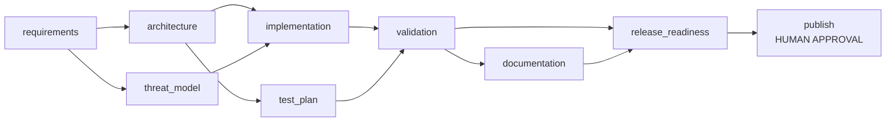
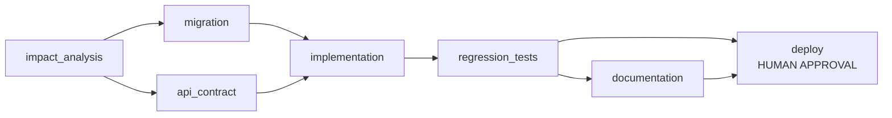
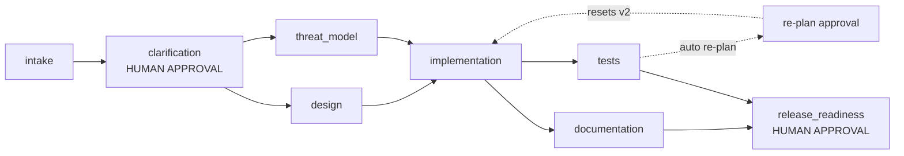

# Scenarios

Three scenarios exercise the same engine under different conditions. Each is a real,
runnable workflow defined in YAML and executed by the reference agents. They are not
storyboards: every stage produces artifacts, runs gates and writes audit events.

Run all three:

```bash
make demo-all
# or
uv run asdlc run greenfield   # pauses at the release gate
```

## 1. Greenfield — build URL shortener v1

**Requirement:** build a URL shortener from scratch with core APIs, analytics, TTL, security,
health/metrics and a releasable deployment.

**Decomposition:** 9 stages, two parallel design branches, a validation join, a readiness gate
and a high-impact deployment approval.



| Stage | Agent | Depends on | Gate | Notes |
|---|---|---|---|---|
| `requirements` | requirements | — | `requirements_normalized` | intent, acceptance criteria, NFRs |
| `architecture` | architecture | requirements | `artifact_present` | components, OpenAPI, data model, SSRF controls |
| `threat_model` | threat_model | requirements | `artifact_present` | STRIDE, abuse cases, residual risk (parallel with design) |
| `implementation` | implementation | architecture, threat_model | `artifact_present` | generates `shortener_core.py` + executable tests |
| `test_plan` | test_plan | architecture | `artifact_present` | risk-based matrix (parallel with implementation) |
| `validation` | validation | implementation, test_plan | `tests_passed` | writes and executes generated tests in isolation |
| `documentation` | documentation | validation | `artifact_present` | runbook, rollback, SLOs |
| `release_readiness` | release | validation, documentation | `release_ready` | checklist + green test evidence |
| `publish` | release | release_readiness | `artifact_present` | **human approval**, `production_deploy` policy |

**Orchestration features exercised**

- Parallel paths (`architecture` ∥ `threat_model`, `implementation` ∥ `test_plan`).
- Join synchronization at `implementation`, `validation` and `release_readiness`.
- Policy `SEC-003` verifies the design documents SSRF/private/redirect controls.
- Policy `CHG-001` requires approval **and** test evidence for production deployment.
- Human approval pauses the run at `publish`; approve resumes, reject fails.
- Real validation: generated tests execute in a subprocess and produce `test-report.md`.

**Representative evidence**

```
Run     : run_…        Status: SUCCEEDED   mode=reference   replans=0
publish PASS 1 1 APPROVED
Audit   : valid (40 events)
Artifacts: requirements.md, architecture.md, openapi.yaml, data-model.sql,
           threat-model.md, generated/shortener_core.py,
           generated/test_shortener_core.py, test-plan.md, test-report.md,
           validation-log.txt, runbook.md, release-checklist.md,
           deployment-record.md
```

Without auto-approval the run stops at:

```
Status: AWAITING_APPROVAL
publish  AWAITING_APPROVAL  approval=PENDING
```

## 2. Brownfield — aliases, analytics and TTL

**Requirement:** extend the existing shortener with custom aliases, TTL, soft delete and
click analytics without breaking existing consumers.

**Decomposition:** impact analysis scans the real modules, then migration and API-contract
review run in parallel, followed by implementation, regression validation, docs and a
change-controlled deploy.



| Stage | Agent | Depends on | Gate | Notes |
|---|---|---|---|---|
| `impact_analysis` | impact_analysis | — | `artifact_present` | scans 5 real modules, maps APIs/data flows |
| `migration` | migration | impact_analysis | `artifact_present` | authors SQL, applies it to a sandbox DB, verifies columns/rows |
| `api_contract` | api_contract | impact_analysis | `artifact_present` | additive-only compatibility review (parallel) |
| `implementation` | brownfield_implementation | migration, api_contract | `artifact_present` | policy-blocked secret on attempt 1, clean on attempt 2 |
| `regression_tests` | validation | implementation | `tests_passed` | executes generated regression tests |
| `documentation` | documentation | regression_tests | `artifact_present` | migration/rollback runbook |
| `deploy` | release | regression_tests, documentation | `release_ready` | **human approval**, production change control |

**Orchestration features exercised**

- **Codebase reasoning:** `impact_analysis` reads `src/agentic_sdlc/shortener/*.py` at runtime
  and reports line/function/change-signal counts against the actual code.
- **Migration validation:** the migration is applied to a throwaway SQLite database and checked
  with `PRAGMA table_info`; evidence is attached as an artifact.
- **Policy-enforced retry:** attempt 1 contains an AWS-style access key (example only); `SEC-001` denies it as
  retryable; attempt 2 removes the secret and succeeds. The denial is persisted and audited.
- **Change control:** deploy requires a recorded approval and green regression evidence.
- **No rollback on success:** the run completes normally; rollback machinery is covered by tests.

**Representative evidence**

```
impact_analysis PASS 1   migration PASS 1   api_contract PASS 1
implementation  PASS 2   regression_tests PASS 1   deploy PASS 1 APPROVED

policy.violation implementation
  SEC-001: hardcoded secret material detected in generated/shortener_extensions.py:aws_access_key
stage.attempt_failed implementation attempt=1 retryable=true
stage.succeeded implementation attempt=2
Metrics: retry_frequency=0.125 (1 retry / 8 attempts), policy_violations=1
```

## 3. Ambiguous — "make links safer with insights"

**Requirement:** an intentionally underspecified request. "Safer" and "insights" could mean
many things; retention and privacy are unstated.

**Decomposition:** ambiguity intake → **human normalization approval** → design + threat model
→ implementation → tests + docs → **auto re-plan approval** (scope change) → regenerated
downstream artifacts → **release approval**.



| Stage | Agent | Depends on | Gate | Notes |
|---|---|---|---|---|
| `intake` | ambiguous_requirements | — | `artifact_present` | five ambiguities, three questions, four assumptions |
| `clarification` | clarification | intake | `artifact_present` | **human approves** normalized interpretation |
| `design` | architecture | clarification | `artifact_present` | design against approved scope |
| `threat_model` | threat_model | clarification | `artifact_present` | privacy/retention threat model (parallel) |
| `implementation` | implementation | design, threat_model | `artifact_present` | retention-aware implementation |
| `tests` | validation | implementation | `tests_passed` | executes generated tests |
| `documentation` | documentation | implementation | `artifact_present` | retention/privacy runbook (parallel with tests) |
| `release_readiness` | release | tests, documentation | `release_ready` | **human approval**, production change control |

**Governed re-plan**

After `tests` succeeds, the scenario's `auto_replan` fires:

- targets: `implementation`, `tests`, `documentation`
- reason: retention is now 90 days and referrer attribution must be explicit
- `require_approval: true` → a `replan` approval is created.

On approval the engine resets those three stages to `PENDING/STALE`, increments `replan_count`,
audits `replan.applied`, and re-executes them. Artifacts become `v2` with lineage:

```
generated/shortener_core.py      v2
generated/test_shortener_core.py v2
test-report.md                   v2
validation-log.txt               v2
runbook.md                       v2
release-checklist.md             v1
```

Approvals in this run: `clarification` (scope), `__replan__` (impact), `release_readiness`
(deploy). All are recorded with actor, rationale and timestamp.

**Ambiguity handling:** the intake artifact explicitly lists what is unknown, why it matters,
the proposed resolution and the blocking questions. The human approval is a gate, not a
formality: the clarification agent records the reviewer and rationale into `clarification.md`,
and the design consumes that artifact.

## 4. Cross-scenario matrix

| Capability | Greenfield | Brownfield | Ambiguous |
|---|---|---|---|
| Parallel branches + join | yes | yes | yes |
| Exit gates | 3 kinds | 2 kinds | 2 kinds |
| Human approval | release | deploy | scope + re-plan + release |
| Retry | available | policy retry | available |
| Rollback path | available | available | available |
| Re-plan | manual | manual | auto + approval |
| Policy denial | design control | secret -> remediated | design control |
| Lineage v2 | via manual re-plan | n/a | auto re-plan |
| Real code execution | yes | yes | yes |

## 5. Reproducing

```bash
# deterministic, all approvals recorded as demo-reviewer
make demo-all

# interactive human gates
uv run asdlc run greenfield
uv run asdlc status <run_id>
uv run asdlc approve <run_id> --rationale "release evidence reviewed"
uv run asdlc audit-verify <run_id>
uv run asdlc metrics

# or use the dashboard: make serve → http://localhost:8000
```

Every run persists in `var/agentic_sdlc.db`; artifacts are under
`var/runs/<run_id>/artifacts/<stage>/`.
